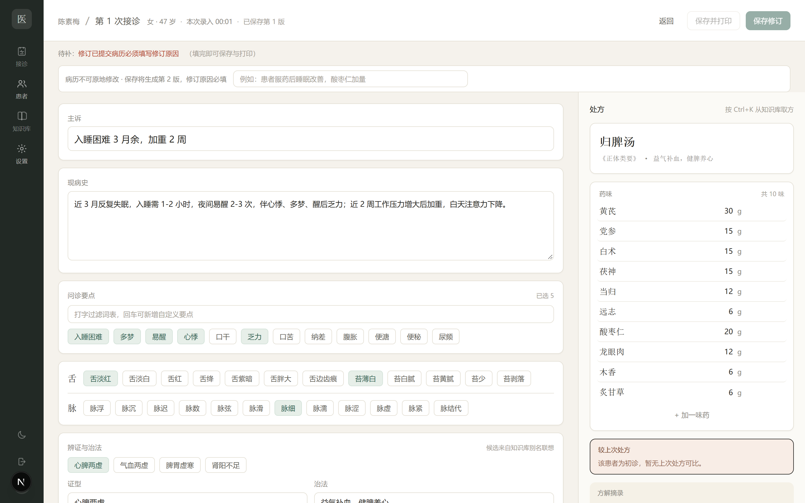
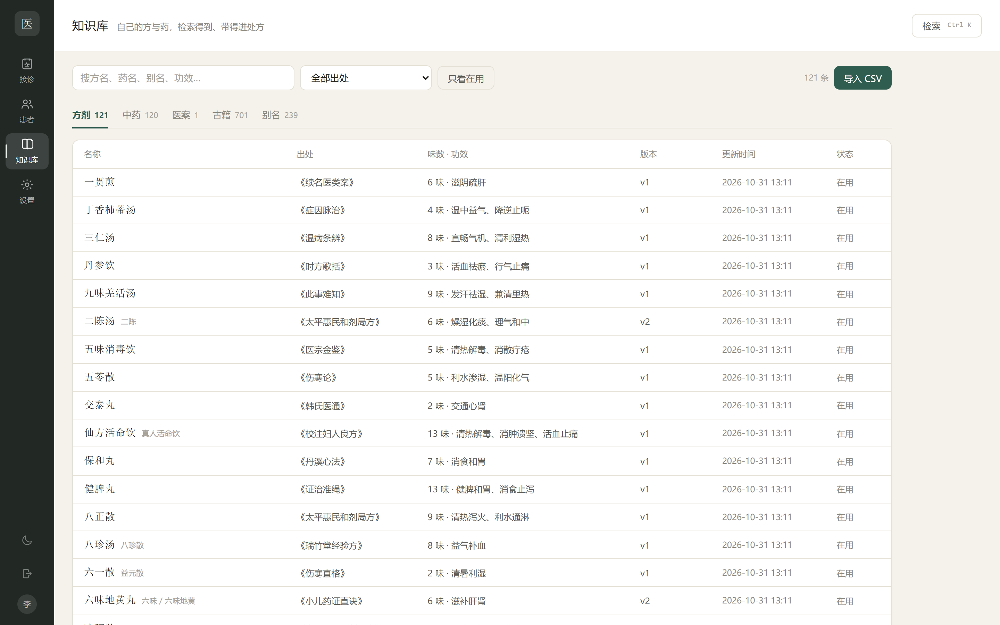
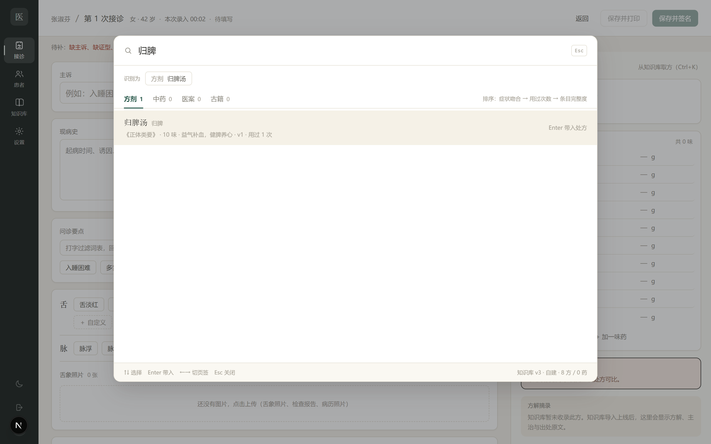
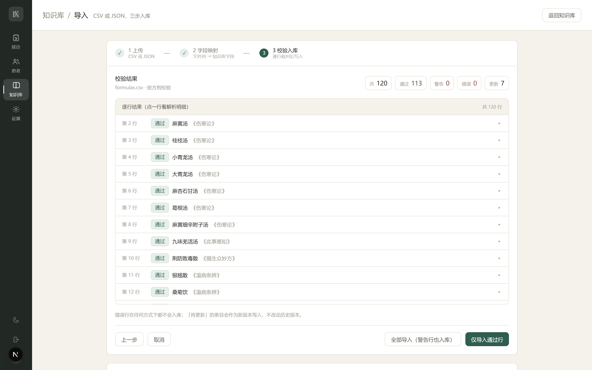
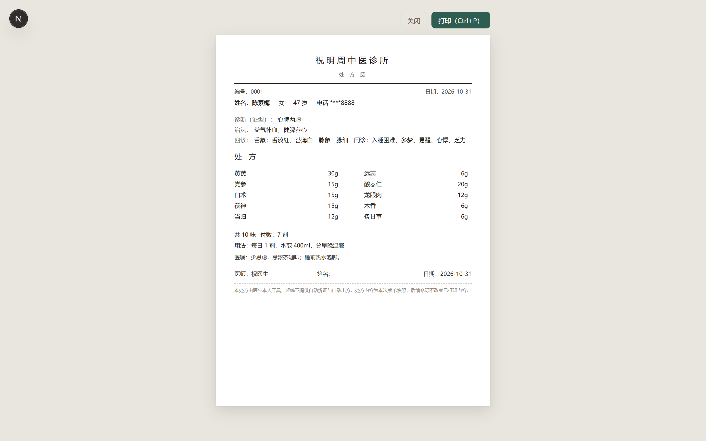

# TCM Clinic Workbench (single practitioner · offline-first)

English | [中文](README.md)

A local-first clinic workstation for an **individual Traditional Chinese Medicine (TCM) practice**: visit notes, a personal knowledge base, prescription printing, follow-up reminders, and backups — all in one app that runs on the doctor's own computer.

Design goals: one doctor, fewer clicks, works offline, data stays local. It is deliberately **not** a multi-doctor / multi-location SaaS.

> ⚠️ **For healthcare professionals as a documentation aid only. Not a medical device; not medical advice.** The system does **not** perform automatic syndrome differentiation and does **not** generate prescriptions. Every prescription must be reviewed and signed by the licensed practitioner. See [Disclaimer](#disclaimer).



## Features

**Consultation (core)**
- Six-card intake: chief complaint → present illness → inquiry points → tongue/pulse → syndrome & treatment principle → advice & follow-up
- Prescription panel: formula name/source, herbs and doses, **diff vs. the previous prescription**, formula commentary, usage; one-click "my favourites / agreed formulas"
- Keyboard-first: fixed Tab order, Enter for next field, `Ctrl+Enter` to save, `Ctrl+K` for the knowledge-base search overlay
- "Bring in last visit", autosaved drafts, herb name autocomplete (pinyin / initials) that remembers usual doses
- Real-time warnings for the classic "eighteen incompatibilities / nineteen mutual antagonisms" (warning only, does not block saving, fully audited)
- Immutable records: signed visits can only gain revision versions with a mandatory amendment reason; side-by-side revision history
- Image attachments (tongue photos, lab reports) stored with the patient

**Knowledge base**
- Curated entries (formulas / herbs / case records / classics), search, filter by source, disable instead of delete, full version history
- Three-step CSV/JSON import wizard: upload → field mapping → validation (E1/E2/E3 errors, W1/W2/W3 warnings) → commit, with batch rollback
- Classic-text full-text search: imported books are chunked by chapter and indexed with SQLite FTS5, so any position in a long book is searchable
- `Ctrl+K` global search overlay: alias-based intent detection, ranking by "symptom overlap → personal usage frequency → entry completeness" (no AI recommendations); press Enter to insert a formula, with replace/append choices when a prescription already exists

**Practice operations**
- Patient records (optional clinic card number, pinyin search), phone numbers masked by default, revealing them writes an audit entry
- Clinic dashboard: unfinished drafts / today's visits / follow-ups due
- Full-record search, audit log with before/after values
- A5/A4 prescription printing with configurable layout, one-click PDF export
- Database backup & full JSON export, restore CLI, configurable retention
- Dark mode, narrow-screen layout

| Knowledge base | Search overlay |
| --- | --- |
|  |  |

| Import wizard | Prescription print |
| --- | --- |
|  |  |

## Tech stack

- **Framework**: Next.js 15 (App Router, Server Actions) + React 19 + TypeScript
- **Styling**: Tailwind CSS 4 (semantic CSS variables, light/dark token sets)
- **Database**: SQLite + Prisma ORM (migrations under `prisma/migrations`)
- **Search**: in-memory inverted index + alias table (formulas/herbs/cases); SQLite FTS5 for classic texts
- **Auth**: cookie session (jose-signed; verified in Edge middleware via WebCrypto)
- **Others**: zod (validation), bcryptjs (passwords), pinyin-pro (pinyin search)
- **Desktop packaging**: Next.js standalone + portable launchers (C# / VBS / bat), optional tray app and per-user installer

## Quick start

Requirements: Node.js ≥ 20 and pnpm.

```bash
# 1. Install dependencies
pnpm install

# 2. Configure environment
cp .env.example .env
# Put a long random string into SESSION_SECRET:
#   node -e "console.log(require('crypto').randomBytes(32).toString('hex'))"

# 3. Initialise the database (schema + immutability triggers + seed data)
pnpm prisma migrate deploy
pnpm db:generate
pnpm db:seed

# 4. Run
pnpm dev
```

Open http://localhost:3000 and sign in with `doctor` / `doctor1234` (change the password under **Settings → Account** on first login).

> Note: `.npmrc` in this repo points pnpm at the npmmirror registry (maintainer is in mainland China). If npmjs.org is reachable for you, change it back to `registry=https://registry.npmjs.org`.

### Seed data

`pnpm db:seed` inserts the default account, sample clinic profile, syndrome keyword sets, tongue/pulse/treatment term libraries, the 18/19 incompatibility pairs, and 8 starter formulas.
`data/seed/` also contains CSVs with 120 formulas and 120 herbs importable via **Knowledge base → Import CSV** (see [data/seed/sources.md](data/seed/sources.md)).

### Optional: import classic texts

```bash
# 1. Put public-domain classics (.txt) into tmp/tcm-books-raw/ (e.g. 000-神农本草经.txt)
node scripts/import-classics.mjs
# 2. Build the FTS5 full-text index
node scripts/build-classic-fts.mjs
```

> Classic texts are **not** distributed in this repository (size + provenance). Only the import scripts are provided; see [THIRD_PARTY.md](THIRD_PARTY.md) for sources and licensing notes.

## Desktop build (Windows)

```bash
# Portable build (no installation; double-click 中医工作台.exe)
node scripts/build-portable.mjs
#   output: dist/中医工作台-本机版/ (bundles node.exe, Prisma engine, database)

# Per-user installer (installs to %LOCALAPPDATA%\Programs\中医工作台, includes uninstaller)
node scripts/build-installer.mjs
#   output: dist/安装包/安装中医工作台.exe + payload.zip
```

Packaging uses the .NET Framework compiler (`csc.exe`) shipped with Windows to build the launchers / tray app / installer — no online tooling required. See [packaging/说明.txt](packaging/说明.txt) (Chinese).

## Project structure

```
app/            pages and Server Actions (auth, patients, visits, knowledge base, search, print, settings)
components/     shared UI (rail, top bar, search overlay, term chips, attachment gallery…)
lib/            domain logic (auth, validation, search index, import parsing, print options…)
prisma/         schema, migrations, seed script
data/seed/      sample formula/herb CSVs and provenance notes
scripts/        import, packaging, screenshot, end-to-end regression scripts
packaging/      desktop launcher / tray / installer sources and notes
docs/           documentation assets such as screenshots
```

## Configuration

`.env`:

| Variable | Description |
| --- | --- |
| `DATABASE_URL` | SQLite path, defaults to `file:./dev.db` in development |
| `SESSION_SECRET` | Session signing secret; use ≥ 32 random bytes |

Clinic name, doctor signature, default usage text, print layout, term libraries and backup retention are all configured inside the app (**Settings**), no code changes needed.

## Data & security

- All data lives in a local SQLite database (`prisma/dev.db`) and `data/uploads`; **nothing is uploaded**, no telemetry.
- Phone numbers are masked by default; revealing the full number writes an audit entry.
- Audit logs and signed visit revisions are protected by database triggers that **reject UPDATE / DELETE**.
- Demo data (e.g. "张淑芬") is fictional and only for UI preview.
- Before exposing the app beyond localhost, add HTTPS, access control and a backup strategy yourself; the default setup targets the doctor's own computer.

## Disclaimer

This project is a **documentation and retrieval tool**. It is not a medical device, does not provide diagnoses, and does not replace clinical judgement:

1. No automatic syndrome differentiation, no automatic prescription generation; prescriptions are entered, checked and signed by the practitioner.
2. The knowledge base (including classic texts and sample formulas) is for study and retrieval only; prescribing decisions remain with the licensed practitioner.
3. Handling of toxic herbs and protected species (e.g. rhinoceros horn, saiga antelope horn, pangolin) is documented in `data/seed/sources.md`; follow local laws and regulations in clinical use.
4. Patient data is sensitive personal information. Secure the device and back up regularly, and comply with applicable privacy laws (e.g. PIPL in China, GDPR where relevant) if you provide the service to others.

## Third-party projects & data

The following open-source projects and public datasets were referenced/used during development; **each is attributed in [THIRD_PARTY.md](THIRD_PARTY.md)**:

- [xiaopangxia/TCM-Ancient-Books](https://github.com/xiaopangxia/TCM-Ancient-Books) — public-domain Chinese medical classics (only the public-domain text is used for local import; this repository does not redistribute the texts)
- [lin-haust/TCM-prescription-datasets](https://github.com/lin-haust/TCM-prescription-datasets) — TCM prescription dataset (field organisation referenced only; no data copied)
- Wikisource and ctext.org — cross-checking public-domain classics
- npm dependencies: Next.js / React / Prisma / Tailwind CSS / jose / bcryptjs / pinyin-pro / zod …

## License

- **Code**: [MIT](LICENSE) © 2026 Zuo Jin (Techxey)
- **Sample data under `data/seed/` and documentation**: CC BY 4.0 (please attribute the project and author when redistributing)
- Classic texts are in the public domain and are not distributed here; when reusing third-party projects/data, also comply with their own licences (see [THIRD_PARTY.md](THIRD_PARTY.md)).

## Contributing

Issues and PRs are welcome. Before submitting, please run:

```bash
pnpm exec tsc --noEmit     # type check
pnpm build                 # production build
node scripts/e2e-regression.mjs   # end-to-end regression (start `pnpm dev` first)
```
