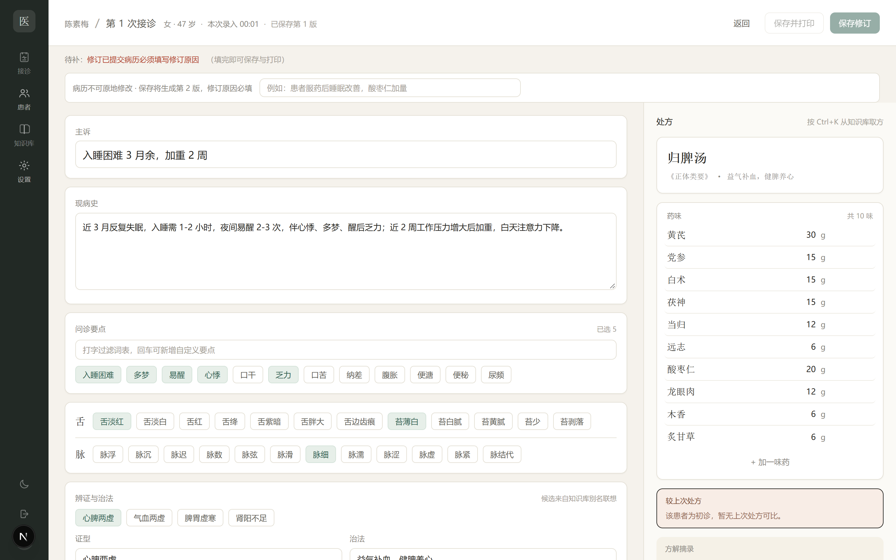
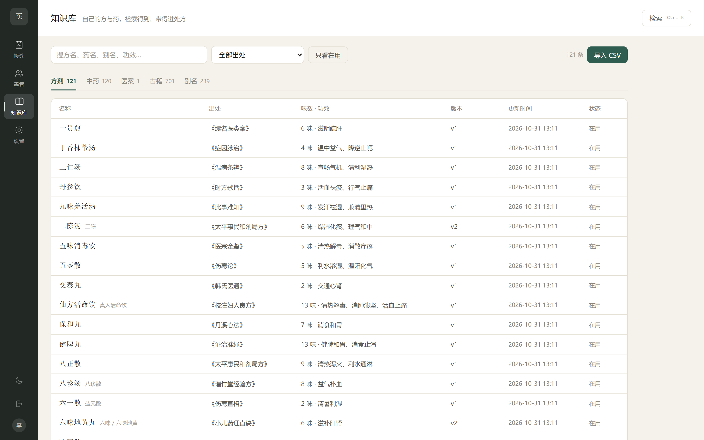
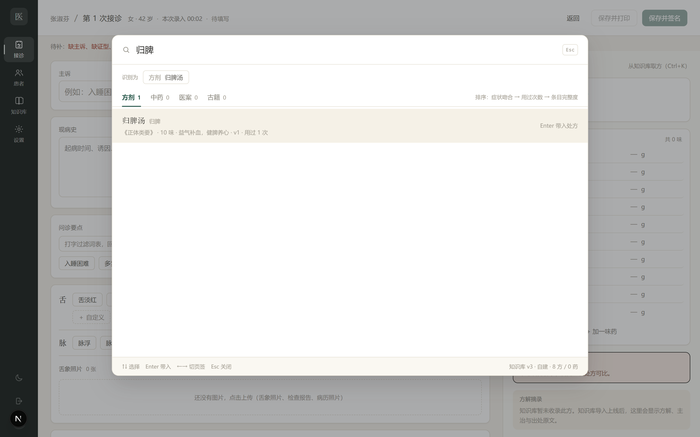
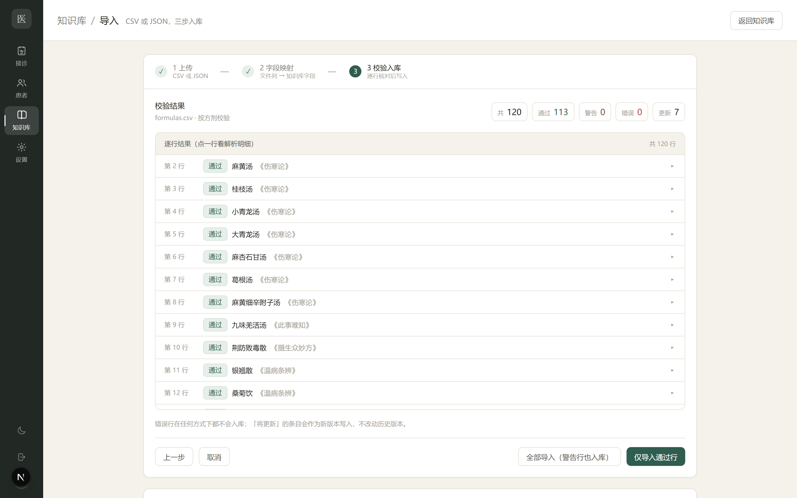
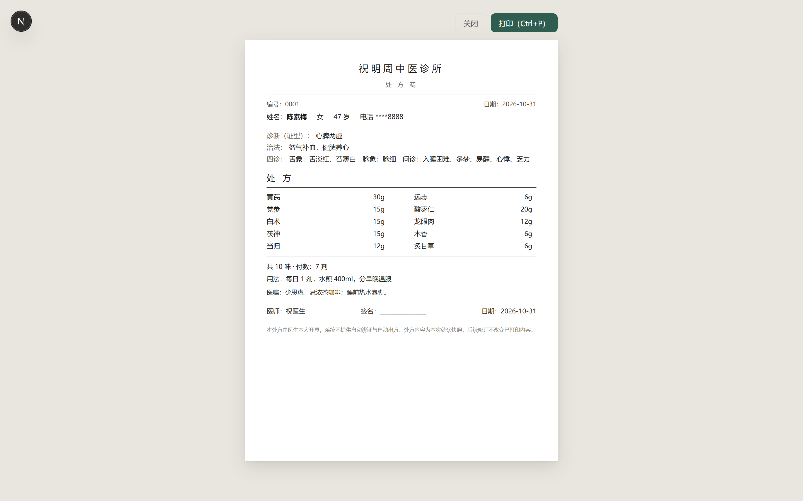

# 中医诊所工作台（单医生 · 离线优先）

中文 | [English](README.en.md)

一个面向**个人中医诊所**的诊疗工作台：接诊记录、知识库、处方打印、复诊随访、备份导出都在一个本地 Web 应用里完成。
设计目标是「单医生、少点击、可离线、数据自己掌握」，不追求做成多医生/多门店 SaaS。

> ⚠️ **仅供医疗从业者辅助记录使用，不是医疗器械，不构成诊疗建议。** 系统不做自动辨证、不自动生成处方；所有处方必须由执业医师本人确认并签名。详见 [免责声明](#免责声明)。



## 功能

**接诊（核心）**
- 六卡录入：主诉 → 现病史 → 问诊要点 → 舌象/脉象 → 证型与治法 → 医嘱与复诊
- 右栏处方：方名/出处、药味与剂量、**较上次处方的加减**、方解摘录、用法；支持「我的常用方 / 协定处方」一键套用
- 键盘流：Tab 顺序固定、Enter 下一项、`Ctrl+Enter` 保存、`Ctrl+K` 打开知识库检索浮层
- 复诊「带入上次记录」、草稿自动保存、药名拼音/首字母补全并记住常用剂量
- 十八反 / 十九畏实时提示（提示不阻止保存，留痕可追溯）
- 病历不可变：已签名病历只能新增修订版本，强制填写修订原因，可并排查看修订历史
- 图片附件：舌象照片、检查报告，随患者归档

**知识库**
- 自建条目（方剂 / 中药 / 医案 / 古籍），支持搜索、按出处筛选、停用不删除、版本历史
- 三步 CSV/JSON 导入向导：上传 → 字段映射 → 校验（E1/E2/E3 错误、W1/W2/W3 警告）→ 入库，支持批次回滚
- 古籍全文检索：导入古籍后按章切块建 FTS5 索引，长书任意位置可搜
- `Ctrl+K` 全局检索浮层：别名识别意图、按「症状吻合度 → 使用频次 → 条目完整度」排序（无 AI 推荐），回车上屏带入处方，已有处方时可选替换/追加

**诊所运营**
- 患者档案（支持门诊卡号、拼音搜索）、手机号脱敏、查看完整手机号留痕
- 接诊首页：未完成病历 / 今日接诊 / 复诊到期提醒
- 整本病历全文检索、操作审计日志（含前后值）
- 处方 A5/A4 打印（版式可配置）、一键导出 PDF
- 数据备份与全量 JSON 导出、恢复 CLI、备份保留天数可配置
- 夜间模式、窄屏布局、浅色/深色主题跟随设置

| 知识库 | 检索浮层 |
| --- | --- |
|  |  |

| 导入向导 | 处方打印 |
| --- | --- |
|  |  |

## 技术栈

- **框架**：Next.js 15（App Router、Server Actions）+ React 19 + TypeScript
- **样式**：Tailwind CSS 4（语义化 CSS 变量 + 浅色/夜间两套 token）
- **数据库**：SQLite + Prisma ORM（迁移文件在 `prisma/migrations`）
- **检索**：内存倒排 + 别名表（方剂/中药/医案）；古籍正文用 SQLite FTS5
- **认证**：Cookie 会话（jose 签名，middleware Edge 侧用 WebCrypto 校验）
- **其它**：zod（校验）、bcryptjs（口令）、pinyin-pro（拼音检索）
- **桌面化**：Next.js standalone + 便携启动器（C# / VBS / bat），可选托盘与免管理员安装包

## 快速开始

环境要求：Node.js ≥ 20、pnpm。

```bash
# 1. 安装依赖
pnpm install

# 2. 配置环境变量
cp .env.example .env
# 生成一个足够长的随机串填到 SESSION_SECRET
#   node -e "console.log(require('crypto').randomBytes(32).toString('hex'))"

# 3. 初始化数据库（建表 + 不可变触发器 + 种子数据）
pnpm prisma migrate deploy
pnpm db:generate
pnpm db:seed

# 4. 启动
pnpm dev
```

打开 http://localhost:3000 ，默认账号 `doctor` / `doctor1234`（首次登录后请在「设置 → 账号」改密码）。

### 种子数据说明

`pnpm db:seed` 会写入：默认账号、示例诊所信息、14 个证型联想词、舌象/脉象/治法词库、25 条十八反十九畏、8 首示例方剂。
`data/seed/` 下另有 120 首方剂与 120 味中药的 CSV，可在「知识库 → 导入 CSV」中导入（字段说明见 [data/seed/sources.md](data/seed/sources.md)）。

### 可选：导入古籍全文

```bash
# 1. 把公版古籍 txt 放到 tmp/tcm-books-raw/（文件名如 000-神农本草经.txt）
node scripts/import-classics.mjs
# 2. 建 FTS5 全文索引
node scripts/build-classic-fts.mjs
```

> 古籍原文不随仓库分发（体积大、且来源需自行确认），仓库只提供导入脚本。来源与许可见 [THIRD_PARTY.md](THIRD_PARTY.md)。

## 打包成桌面版（Windows）

```bash
# 便携版（免安装，双击 中医工作台.exe 运行）
node scripts/build-portable.mjs
#   产物：dist/中医工作台-本机版/（自带 node.exe、Prisma 引擎、数据库）

# 免管理员安装包（安装到 %LOCALAPPDATA%\Programs\中医工作台，含卸载器）
node scripts/build-installer.mjs
#   产物：dist/安装包/安装中医工作台.exe + payload.zip
```

打包脚本用系统自带的 .NET Framework 编译器（`csc.exe`）生成启动器 / 托盘 / 安装器，无需联网安装构建工具。详见 [packaging/说明.txt](packaging/说明.txt)。

## 项目结构

```
app/            页面与 Server Actions（登录、患者、接诊、知识库、检索、打印、设置）
components/     通用组件（侧栏、顶栏、检索浮层、词条 chips、附件画廊…）
lib/            业务逻辑（认证、校验、检索索引、导入解析、打印配置…）
prisma/         数据模型、迁移、种子脚本
data/seed/      示例方剂/中药 CSV 与来源说明
scripts/        导入、打包、截图、端到端回归等脚本
packaging/      桌面版启动器 / 托盘 / 安装器源码与说明
docs/           README 截图等文档资源
```

## 配置

`.env`：

| 变量 | 说明 |
| --- | --- |
| `DATABASE_URL` | SQLite 路径，开发默认 `file:./dev.db` |
| `SESSION_SECRET` | 会话签名密钥，请使用 32 字节以上随机串 |

诊所名称、医生署名、默认用法、打印版式、词库、备份保留天数等都在应用内「设置」里配置，不需要改代码。

## 数据与安全

- 所有数据保存在本机 SQLite（`prisma/dev.db`）与 `data/uploads`，**不上传任何服务器**，也没有遥测。
- 手机号在列表/页面上默认脱敏，查看完整号码会写审计日志。
- 审计日志与已签名病历在数据库层通过触发器**禁止 UPDATE / DELETE**。
- 演示数据（如「张淑芬」）均为虚构，仅用于界面预览。
- 部署到公网前请自行增加 HTTPS、访问控制与备份策略；当前默认面向「医生本人电脑」。

## 免责声明

本项目是**记录与检索工具**，不是医疗器械、不提供诊断结论、不替代医师判断：

1. 系统不会自动辨证、不会自动生成处方；处方内容由医师本人录入、核对并签名。
2. 知识库（含古籍、示例方剂）仅供学习与检索参考，用药须结合患者实际情况由执业医师决定。
3. 涉及毒性药、保护物种（如犀角、羚羊角、穿山甲）等的处理与提示，见 `data/seed/sources.md`；临床使用请遵守当地法律法规。
4. 患者数据属于敏感个人信息，请自行做好设备安全与备份；如需对外提供服务，请遵守《个人信息保护法》《数据安全法》及所在地法规。

## 第三方与数据来源

本项目在开发中参考/使用了以下开源项目与公开数据，**已在 [THIRD_PARTY.md](THIRD_PARTY.md) 中逐项标注**：

- [xiaopangxia/TCM-Ancient-Books](https://github.com/xiaopangxia/TCM-Ancient-Books) —— 公版中医古籍文本（本项目仅用其公有领域原文做本地导入，仓库不分发原文）
- [lin-haust/TCM-prescription-datasets](https://github.com/lin-haust/TCM-prescription-datasets) —— 方剂数据集（仅参考字段组织方式，未复制数据）
- 维基文库、中国哲学书电子化计划（ctext）—— 公版古籍检索核对
- Next.js / React / Prisma / Tailwind CSS / jose / bcryptjs / pinyin-pro / zod 等 npm 依赖

## License

- **代码**：[MIT](LICENSE) © 2026 左晋（Techxey）
- **`data/seed/` 示例数据与文档**：CC BY 4.0（转载/再分发请注明来源与本项目链接）
- 古籍原文来自公有领域，不随仓库分发；引用第三方项目/数据时请同时遵守其各自许可（见 [THIRD_PARTY.md](THIRD_PARTY.md)）。

## 贡献

欢迎提 Issue / PR。提交前请确保：

```bash
pnpm exec tsc --noEmit     # 类型检查
pnpm build                 # 生产构建
node scripts/e2e-regression.mjs   # 端到端回归（需先启动 dev）
```
